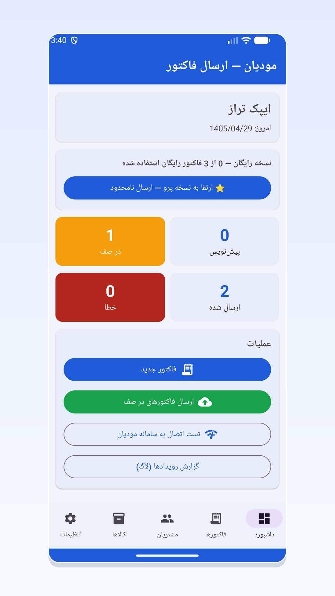
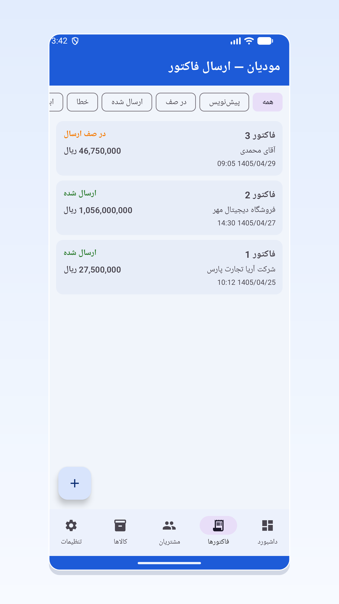
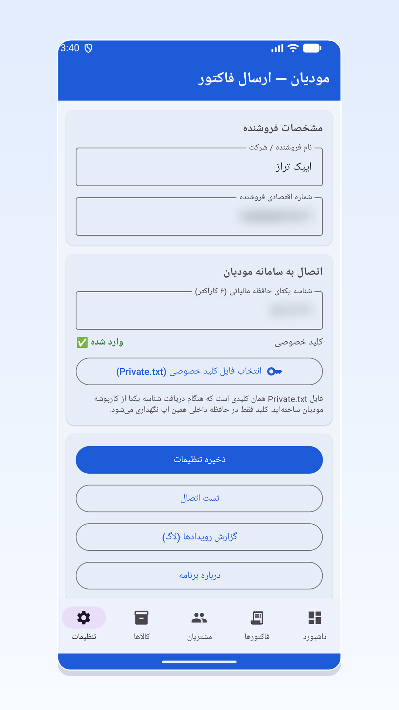

# Ipak Taraz – Moadian E-Invoice App

A Python-built mobile app that lets Iranian taxpayers send electronic invoices **directly from their phone** to the official Moadian system of the Iranian National Tax Administration (tax.gov.ir), with no computer and no intermediary server.

> Independent helper tool. Not affiliated with the Iranian National Tax Administration.

## Features

- Issue and send sales invoices to the Moadian system (no relay server)
- Cancel invoices and issue sales returns, referencing the tax ID of the original invoice
- Send queue: save invoices and submit them all at once whenever you like
- Customer and product book, with Moadian product IDs and permitted units
- Automatic VAT calculation and invoice totals
- Event log to track the status of every submission
- Fully Persian, right-to-left interface with Jalali (Shamsi) dates
- Light and dark themes

## Privacy and security

The private key and all user data are stored **only on the user's device**. Nothing is sent to any server except the official Moadian system (tax.gov.ir).

## Requirements

1. A tax memory unique ID (*Shenase-ye Yekta-ye Hafeze-ye Maliyati*) from the Moadian taxpayer portal (my.tax.gov.ir)
2. The private key file (`Private.txt`) generated when the ID was issued
3. An internet connection without a VPN (the Moadian system only responds to Iranian IP addresses)

## Pricing model

The first 3 invoices are free. After that, users can buy a 200-invoice pack inside the app.

## Tech stack

- Python

## Screenshots

| Dashboard | Invoices | Settings |
|:---:|:---:|:---:|
|  |  |  |

## Author

Behnam Manzar Khosroshahi
[LinkedIn](https://www.linkedin.com/in/behnam-manzar-khosroshahi-0a5854446) · [GitHub](https://github.com/behnammanzar)
